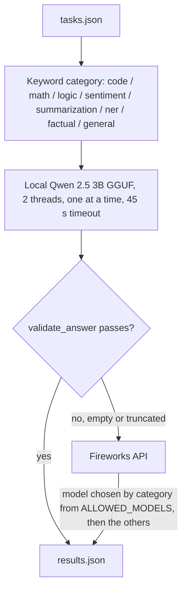

# AMD Hackathon Track 1: Local-First Task Router

> A headless batch agent that answers mixed text tasks with a 4-bit Qwen 2.5 3B model on CPU and falls back to Fireworks-hosted models only when the local answer fails a check, built for a grader with no GPU, 2 vCPUs, 4 GB RAM and a 10-minute limit.

**Status:** Hackathon prototype for the AMD Developer Hackathon, Track 1. Routing is keyword-based; there is no trained classifier.
**Demo:** none linked yet. The container image is public: `ghcr.io/hamzakhanbuic/amd-developer-hackathon-track1:latest`.

---

## How it works



- **Categories** come from keyword lists in `backend/router.py` (`determine_category`).
- **Local tier:** every task is tried first on `qwen2.5-3b-instruct-q4_k_m.gguf` through `llama-cpp-python` (`n_threads=2`, `n_ctx=2048`). A semaphore and a lock allow one local inference at a time (`backend/agent.py`). If `llama-cpp-python` or the model file is missing, the local tier is disabled and everything goes to the API.
- **Check:** `validate_answer` applies simple per-category rules (for example, sentiment answers must contain "positive", "negative", "neutral" or "mixed"). It is a format check, not a correctness check.
- **Cloud fallback:** `backend/fireworks_client.py` calls Fireworks through the OpenAI SDK with a 15 s timeout and per-category `max_tokens`. The first model tried depends on category (code, math/logic, other); the remaining `ALLOWED_MODELS` follow.
- **Resource limits** (no GPU, 4 GB RAM, 2 vCPUs, 10 minutes, image under 10 GB) come from the hackathon rules in `docs/TRACK_1_REQUIREMENTS.md`. The code respects them by using 2 threads and one local inference at a time; memory use and total run time were not measured.

## Quickstart

The intended way to run it is the container, which downloads the ~2 GB model at build time.

```bash
docker build -t amd-router .
docker run --rm \
  -v "$(pwd)/input:/input" \
  -v "$(pwd)/output:/output" \
  -e FIREWORKS_API_KEY=your_key \
  -e ALLOWED_MODELS="model-a,model-b" \
  amd-router
```

Reads `/input/tasks.json` (a list of `{"id": ..., "prompt": ...}`) and writes `/output/results.json`. `test_image.ps1` shows the same run with the published image and the model list used in the hackathon. If the input file is missing, the agent runs three built-in dummy tasks.

Without Docker: `pip install -r backend/requirements.txt`, then `python backend/agent.py --input input/tasks.json --output output/results.json`. This needs the GGUF file in the working directory for the local tier, and building `llama-cpp-python` needs a C/C++ toolchain.

Output format (no timing or tier fields):

```json
[{"task_id": "task-001", "answer": "..."}]
```

## Configuration

| Variable | Default | Description |
| :-- | :-- | :-- |
| `FIREWORKS_API_KEY` | none (falls back to `API_KEY`, `OPENAI_API_KEY`, then the literal `dummy`) | Key for the cloud fallback |
| `FIREWORKS_BASE_URL` | `https://api.fireworks.ai/inference/v1` | API base URL |
| `ALLOWED_MODELS` | empty | Comma-separated model names the fallback may use; `backend/router.py` picks cheap, code and expensive models from it by name |
| `TASK_INPUT_PATH` | `/input/tasks.json` | Input file (or `--input`) |
| `TASK_OUTPUT_PATH` | `/output/results.json` | Output file (or `--output`) |

## Limitations

- **There is no XGBoost, embedding or confidence-score routing.** Earlier descriptions of this project claimed that; the code never had it. `docs/ARCHITECTURE.md` and `docs/BACKEND_TASKS.md` still describe that original plan and do not match the code.
- **Prompts are not compressed** (`prune_prompt` only strips whitespace) and every category uses the same one-sentence system prompt.
- **Math and code are not sent straight to the cloud.** Every task is tried locally first. The deterministic solver (`backend/deterministic_solver.py`) is disabled and returns nothing.
- **The answer check is shallow,** so a wrong but well-formed local answer is accepted.
- **If every model fails, the answer is the text "Error: All models failed."** and the run still exits normally. A missing API key becomes `dummy`, so the failure only shows up as API errors in the log.
- **Tests are broken.** `judge_evaluator.py` fails with a `TypeError` (it targets an older router API), `backend/test_router.py` imports a function that no longer exists, and `dataset.csv` has only a header. There is no working test suite, and CI only builds and publishes the image.
- **`backend/requirements.txt` was missing `sympy`,** which `deterministic_solver.py` imports, so the agent crashed on start in a clean install; this PR adds it. `backend/main.py` (a FastAPI app), `backend/Dockerfile` and `docker-compose.yml` are a dead path: `fastapi` is not in the requirements and `main.py` imports a function (`route_query`) that does not exist.
- `frontend/` is a Next.js pitch UI for the demo video. It does not call the backend.
- `stephen_repo` is a broken git submodule entry (no `.gitmodules`).
- Not measured here: local-model accuracy, memory use, and total run time against the 10-minute limit. The Docker image was not built in this review.

## License

MIT. See [LICENSE](LICENSE).
